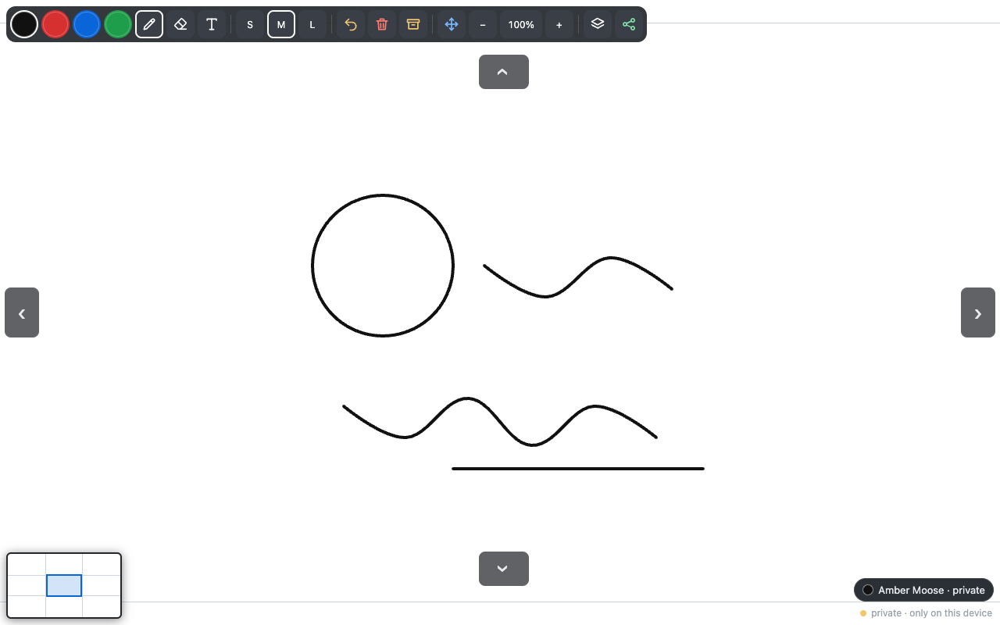
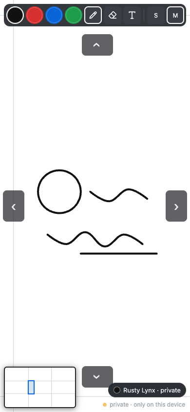
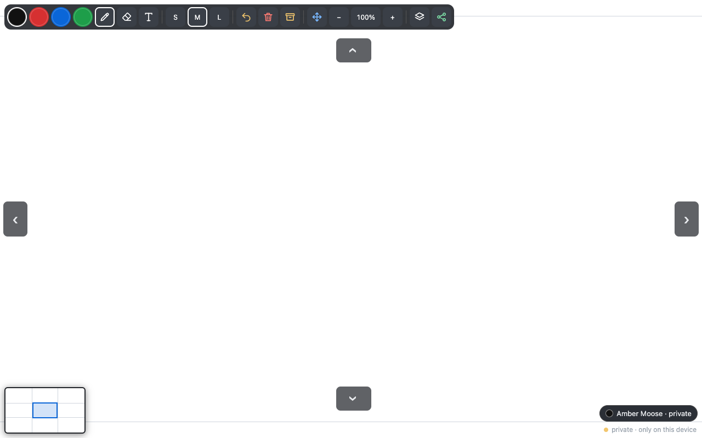
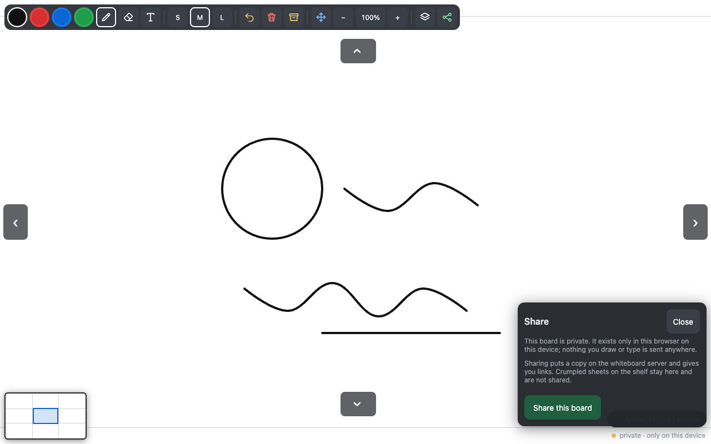

# Plasma Whiteboard

A shared whiteboard that works like a pastebin: open the page, draw, press Share, send the link. No accounts.

**Try it live: https://whiteboard.quixoticv.io**

| Desktop | Phone |
| --- | --- |
|  |  |

## What it is

A live shared whiteboard. Opening the site gives you a **private board** that exists only in your browser; nothing is
sent to a server until you press **Share**. Sharing creates the board on the relay and gives you two links: an
**edit link** and a **view-only link**. Anyone holding a link can open it; there are no accounts, the link is the key.
Strokes appear for everyone in real time, each person gets a colour and a layer, and boards are stored in SQLite and
survive a restart.

It is built for pen, finger and mouse. Finished strokes are smoothed (Ramer-Douglas-Peucker simplification, plus a
curve through fast-written points and two-sided smoothing for finger strokes), the pen draws with pressure, and
on a phone the board starts at 100% so a finger has room to write. See "Tablet and pen" below for the exact rules.

## How to use it

1. **Create a board.** Open the site. You are on a new private board; the status line says "private · only on this device".
2. **Draw.** Pick a colour, pen, eraser or text, and a size (S, M, L). Undo, zoom, pan, and move between the nine
   connected pages with the arrows. Crumple wipes the board onto a shelf of up to five.
3. **Share.** Open the share panel (the share icon) and press **Share this board**. The board is created on the server and
   you get the edit link and the view-only link.
4. **Join.** Send the edit link to people who should draw and the view link to people who should only watch. Opening
   a link joins the board; the people chip at the bottom right lists who is there.

## Run it yourself

Needs Rust with the `wasm32-unknown-unknown` target (`rustup target add wasm32-unknown-unknown`); `make linux` also needs Docker.

    make test     # smooth tests, relay unit and end-to-end tests, JS syntax check
    make run      # http://127.0.0.1:8787, page served from web/ so edits show on reload
    make relay    # release binary at relay/target/release/wb-relay
    make linux    # static Linux x86-64 binary in relay/target-linux/release/

Open `http://127.0.0.1:8787/`. The status line at the bottom right shows the connection, your role, the simplifier in
use (`wasm` or `js`) and how many browsers are on the board.

## Features

- Each board has two links: an **edit link** and a **view-only link**. The link is the key; there are no
  accounts.
- Each browser is a contributor with its own colour and its own layer.
- Hiding a layer affects only your browser. Deleting a layer affects everyone and can be undone.
- Boards are stored in SQLite and survive a restart.
- **Text annotations:** pick Text, tap the board, type. Enter finishes, Shift+Enter starts a new line, Escape
  cancels. Tap your own text with the Text tool to edit it. Size follows S, M, L.
- **Crumple:** wipes the board for everyone and puts it on a shelf of up to five crumpled boards. **Shelf**
  shows them with a small preview; **Bring back** swaps one in and crumples the board in use in its place.
  A sixth crumple throws the oldest away. The toast after a crumple has an Undo.
- **Nine connected pages.** The board is one continuous sheet of 3 by 3 pages; you start on the centre one.
  The arrows at the window's edges (or the arrow keys) move a page at a time. At 100% a page fills the
  window with a little of its neighbours showing, so a line can run from one page onto the next. The zoom
  button (or `0`) switches between the current page and all nine. The map at the bottom left shows where
  you are; tap or drag on it to go anywhere.
- **Tools:** pencil, eraser and Text are separate buttons; picking one switches to it. While a stroke is being
  drawn the toolbar, page arrows and map fade and let the pen pass through them.
- **Zoom** up to 8x, local to your browser. Two-finger pinch, trackpad pinch, Ctrl or Cmd + wheel, the
  toolbar buttons, or the `+`, `-` and `0` keys. Scrolling pans; so does a middle-button drag or Space + drag.
  The **Move** tool makes any drag (pen, finger or mouse) pan. Whenever part of the board is off screen, a small map at the bottom
  left shows where you are; tap or drag on it to go there. On a view link one finger or the mouse pans.

### Private until shared

Opening the site gives a **private board**: it exists only in that browser, on that device. No board is made
on the server and no connection is opened; the page loads its own files and nothing else. The status line
says "private · only on this device". The board is kept in the browser's storage, so a reload keeps it.
Drawing, text, undo, erase, crumple and the shelf all work.

**Share** (in the share panel) is the only way out: it creates the board on the server, uploads what is on
the sheet, and shows the edit and view links. Crumpled sheets on the private shelf are not uploaded. Once
everything is confirmed the browser's private copy is removed, and opening the site again gives a new blank
private board. One private board per browser for now.

### People, names and pings

- Everyone who can draw gets a two-word name and a colour. The chip at the bottom right opens the list of
  people; there you can type your own name, roll a new one, or pick your colour with the slider. Both are
  remembered in the browser. The relay keeps them only while the board is open.
- **Ping:** press the ping button and circle something. The shape glows in your colour for everyone for a
  few seconds with a letter (A, B, C ...) and is never stored. Others see a chip fade in ("B · Amber Otter
  is pointing"); tapping it takes them there. Nobody's view is moved for them. There are no shared cursors.

### Tablet and pen

- **Fast writing.** A finger moving fast is reported only about 60 times a second, so a quick cursive loop
  arrives as a few far-apart points. When the finger lifts, the gaps are filled along a curve through the
  points (centripetal Catmull-Rom) before smoothing.
- **Pen thickness** is constant on the screen (S, M, L are about 2, 4 and 9 px) whatever the device or zoom.

- **Finger on a phone.** The board starts at 100%, so an upright phone shows about a third of a page and a
  finger has room to write. Finger strokes are smoothed when the finger lifts: re-sampled at even steps and averaged with
  their neighbours on both sides, so there is no lag while drawing and the ends stay put. The arrows move most of a screenful when a
  whole page does not fit across the screen; the zoom button cycles 100%, the whole page, all nine pages.

- The pen draws, with pressure. The eraser end of a pen erases.
- Two fingers pinch to zoom and pan. They never draw.
- One finger draws until a pen has touched the board in that browser. After that single fingers are ignored,
  so a resting hand leaves no marks. Touches that land while the pen is down, or within 0.4 s of it, are
  ignored too.
- Text boxes are ordinary text fields, so handwriting-to-text input (Scribble on an iPad) works in them.

## Parts

| Path | What |
| --- | --- |
| `relay/` | The relay: one Rust binary (axum, tokio, SQLite in WAL mode). Serves the page, makes boards, relays strokes. The page is embedded in the binary. |
| `web/` | The page: plain HTML, CSS and JS. No framework and no build step. |
| `crumple/` | The crumple animation in Rust, built to WebAssembly: each frame it computes a paper mesh (wrinkle, wad, toss), which the page draws with WebGL using a picture of the board as the paper. Without it, or with reduced motion set, crumpling still works, without the animation. |
| `smooth/` | Stroke simplification in Rust (Ramer-Douglas-Peucker over x, y, pressure), built to WebAssembly. The page falls back to the same algorithm in JS if the module does not load. |
| `PROTOCOL.md` | The wire contract between page and relay, and the limits. |

## Settings

Environment variables for `wb-relay`:

| Variable | Default | Meaning |
| --- | --- | --- |
| `WB_ADDR` | `127.0.0.1:8787` | Listen address. |
| `WB_DB` | `whiteboard.db` | SQLite file. |
| `WB_TTL_DAYS` | `90` | A board not opened for this many days is deleted. `0` keeps boards for ever. |
| `WB_MAX_LOADED_MB` | `144` | What all open boards may hold in memory together. Past it, new boards get `busy` and new strokes `no`. Keep it well under the unit's `MemoryMax`. |
| `WB_MAX_ROOMS` | `2000` | Boards open at once. |
| `WB_TRUST_PROXY` | unset | Set to `1` behind a reverse proxy you run, so rate limits use the last `X-Forwarded-For` address. Leave unset when the relay faces the network directly. |
| `WB_WEB_DIR` | unset | Serve the page from this directory instead of the copy in the binary (development). |

The relay speaks plain HTTP. Put it behind a TLS proxy (nginx or Caddy; see `deploy/`) for anything beyond
your own machine. Requests from pages on another site (a foreign `Origin`) are refused. The
page uses `wss:` on its own when served over HTTPS.

## Deploy

Set `HOST` (the ssh target, e.g. `root@server`) and `DOMAIN` (your public hostname):

    make ship HOST=root@server DOMAIN=whiteboard.example.org

This runs the tests, builds the Linux binary and installs it with `deploy/deploy.sh` (systemd unit
`deploy/whiteboard.service`). Put TLS in front of the relay once: either nginx (`deploy/nginx-whiteboard.conf`, then
`DOMAIN=your.domain sh deploy/issue-cert.sh` for a Let's Encrypt certificate) or Caddy (`deploy/Caddyfile.site`). Replace
`whiteboard.example.com` in those files with your domain. `deploy/HOST.example.md` is a template for your own host notes:
copy it to `deploy/HOST.local.md`, which is gitignored.

## How it works

A Rust relay (axum, tokio, SQLite) serves a plain HTML/CSS/JS page and relays strokes over WebSocket; the page uses two small Rust modules compiled to WebAssembly (stroke smoothing and the crumple animation). The wire contract is in [`PROTOCOL.md`](PROTOCOL.md); design history and plans are in [`DESIGN-NOTES.pdf`](DESIGN-NOTES.pdf).

- **Keys.** The edit key is 144 random bits. The view key is derived from it with HMAC-SHA256, so an edit
  link can show the view link but not the reverse. The database holds only hashes of both.
- **Identity.** On an edit link the browser makes a random secret for that board and keeps it in
  `localStorage`. The relay maps it to a layer number and assigns the colour. The same browser gets the same
  layer back after a reload or a relay restart. Clearing site data makes a new contributor.
- **Strokes.** Points are vectors in page-width units (centre page x 0 to 1, y 0 to 0.5625; the surface is 3 by 3 pages). The page shows a stroke
  live while it is drawn, simplifies it when the pen lifts, and sends the final points. The relay gives each
  stored stroke a sequence number; clients draw in that order. Strokes are never edited: undo, layer delete
  and restore flip a state flag.
- **Offline.** Strokes drawn while disconnected are kept and sent when the connection returns.
- **Ordering.** The relay handles one board's messages one at a time and broadcasts in that order.
- **Storage.** One thread owns the SQLite connection and batches writes into transactions, so drawing never
  waits on disk. A crash can lose the last few milliseconds of strokes.

## Limits

See the table at the end of `PROTOCOL.md`. The main ones: 10,000 strokes and 16 MB of stroke data per board, 20,000 points per
stroke, 200 contributors per board, 100 connections per board.

## Not yet proven

- **A real pen and tablet.** Pressure, palm rejection, the pen's eraser end and two-finger pinch have been
  exercised with a mouse and with scripted pen and touch events in Chrome, not with real hardware. On an
  iPad the on-screen keyboard may cover a text box placed low on the board.
- **A slow tablet.** Redraws are time-sliced at 6 ms per frame and the device pixel ratio is capped at 2,
  but this has not been measured on real hardware.

## Licence

Apache License 2.0. See `LICENSE` and `NOTICE`.
